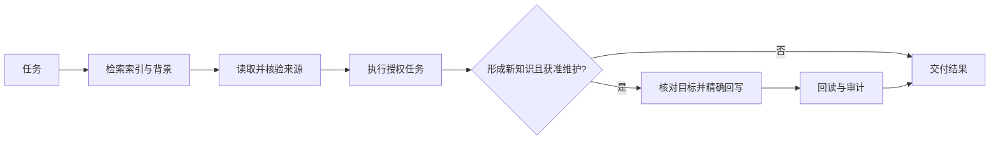

# 设计说明

## 三类信息

| 层 | 内容 | 作用 |
|---|---|---|
| 记忆 | 项目页、日记、经验 | 保存有来源的事实和决策 |
| 索引 | 项目身份、别名、知识目标、机器路径 | 找到正确材料与写入位置 |
| 流程 | Agent 指令、检索、核验、回写、审计 | 约束如何使用信息 |

项目注册表使用稳定 ID；本机路径单独保存，方便迁移。历史材料与当前权威入口分开。知识页保留来源日期和核验状态，以避免把旧结论直接沿用到今天。

## 工作闭环

## 边界

日记提供日级汇总，项目页提供持续状态，经验页提供可复用方法。三者可以互相链接，不在多处复制整段状态。

Obsidian 只浏览 `memory/`，系统目录位于外层。Markdown 保持可迁移；索引和脚本不依赖特定 Agent 产品。

本模板没有自带并发锁、自动事实检查、检索服务和调度器。更复杂的部署可增加这些能力，但须分别验证，不把流程指令描述成运行时保证。
